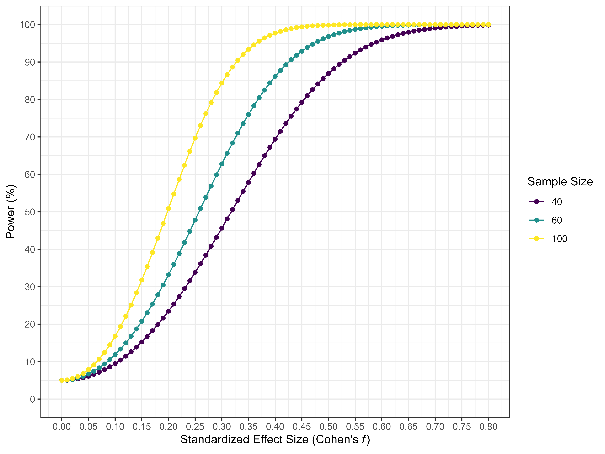

```{r}
#| label: setup-analysis-objects
#| include: false

source("scripts/functions.R")

e1 <- load_analysis_objects("analysis_e1")
e2 <- load_analysis_objects("analysis_e2")
pooled <- load_analysis_objects("analysis_pooled")
meta <- load_analysis_objects("meta_analysis")
pow <- load_analysis_objects("power")

# Inline reporting helpers
num <- function(x, digits = 2) format_num_latex(x, digits)
diff_bin <- function(bin) subset(pooled$pred_bins, abs(Bin - bin) < 1e-8 & Value == "Difference")
diff_exp <- function(experiment, ph) subset(pooled$diff_exp, Experiment == experiment & phase == ph)
excl <- function(o, phase, what) num(o$exclusions[[what]][o$exclusions$Phase == phase])
```

# Introduction

[Most accounts of attentional orienting distinguish between two types of influences]{.rev}: (1) top-down, "voluntary" or endogenous orienting (orienting attention according to [goals]{.rev}, intentions, or task demands); and (2) bottom-up, "involuntary" or exogenous orienting (orienting attention to potentially relevant stimuli) [@jonides1981]. A paradigm that allows the study of attentional orienting and the dissociation between these two types of orienting is the "costs and benefits" paradigm by @posner1984. In this paradigm, a target is presented to the left or right of fixation, and participants are asked to respond as quickly and accurately as possible. Different spatial cues preceding the target and indicating its location can be used to investigate endogenous and exogenous attentional orienting. [Central cues that predict the target location are used to investigate endogenous orienting.]{.rev} Compared to a neutral condition, responses are faster at the location predicted by the cue (valid trials), leading to the so-called attentional benefit effect, and slower at the opposite, invalid location, leading to the so-called attentional cost effect. To investigate exogenous, more automatic attention, peripheral cues are used to cue the appearance of the target, but critically, the cues are not predictive of the target location, so in 50% of the trials the cues indicate where the target will appear (cued location trials) and in the other 50% the cue appears at the opposite location (uncued location trials). Although the observed effects depend on the task set and other factors [@chica2014], the typical pattern of results consists of faster reaction times (RTs) for cued than uncued location trials (facilitation effect) when stimulus onset asynchrony (SOA) is short (typically less than about 200 ms); conversely, for larger SOAs, RT for cued location trials is slower than that for uncued location trials, an effect @posner1985 called inhibition of return (IOR) [although see @berlucchi2006, for a discussion of the inappropriateness of the name].

[Moreover, the]{.rev} interplay between attention and motivation is an important determinant of performance in many tasks [@esterman2016; @padmala2011]. The effect of motivation on attention is often explained by an improvement in cognitive control mechanisms [@botvinick2015]. Therefore, when trying to predict how motivation modulates attentional orienting, it is reasonable to expect that motivation will improve endogenous rather than exogenous orienting. To demonstrate the interaction between motivation and attentional orienting, @engelmann2014 used a detection task from a spatial cueing paradigm with peripheral and predictive cues to investigate how economic gains and losses interact with spatial orienting. In their task, the background color signaled whether participants' performance would lead to the possibility of gaining money or avoiding losing money. In this setting, @engelmann2014 found that either reward or punishment produced an increase in performance regardless of the validity of the cue. That is, reward-induced motivation produces an increase in performance in exogenous orienting and reorienting processes. Although the lack of interaction could be explained by the fact that motivation similarly affects orienting (on valid trials, thus increasing attentional benefits or the attentional facilitation effect) and reorienting processes (on invalid trials, thus reducing attentional costs), one difficulty in concluding that reward modulates exogenous orienting is that although the type of cue affects the type of [orienting that is measured]{.rev}, so does its predictability [@lupianez2004]. Thus, the use of peripheral informative cues does not allow [a proper dissociation of]{.rev} exogenous [and]{.rev} endogenous orienting processes.

One of the first studies attempting to investigate the effect of reward on a completely exogenous orienting task was proposed by @bucker2014. In their work, @bucker2014 used a discrimination task based on the spatial cueing paradigm described above. They used two SOAs (170 ms and 970 ms) and alternating blocks in which participants had the opportunity to receive a [low or high]{.rev} reward (\$0.1 or \$1). The results observed by @bucker2014 show that while the value of the reward does not affect RTs in the short SOA, it does in the long SOA, with the IOR effect disappearing in the low-reward blocks. @bucker2014 argue that this pattern is explained by the fact that the administration of monetary rewards does not affect the initial orientation of attention, which is purely exogenous, while it does affect IOR since the inhibition of the previously attended location depends on top-down processes. In light of these findings, they conclude that performance-based rewards influence endogenous but not exogenous orienting.

[However]{.rev}, while rewarding performance generally influences the participant's motivational state, contingently associating a stimulus feature with reward may affect more specific processes. For example, this specific association appears to alter the ability of that stimulus feature to capture attention [@anderson2011a; @dellalibera2009], even when the stimulus predicting reward acts as an irrelevant distractor so that attending to it is completely counterproductive [@lepelley2015; @lepelley2017], or when reward is no longer available to motivate performance [@anderson2017; @anderson2011a; @watson2019; @garrefrutos2024; @garrefrutos2025]. [Because]{.rev} this bias does not [depend on]{.rev} endogenous factors or the intrinsic capacity of the stimulus to capture attention, [it]{.rev} has been proposed as an effect belonging to the so-called selection history [@anderson2021] that involuntarily influences attentional orienting.

In the above study, @bucker2014 investigated how performance-based reward affects attentional orienting from a spatial cueing paradigm, but they did not show evidence of how stimulus-reward association could affect orienting. Some studies have tried to disentangle how color-reward association could interact with attentional orienting by using cueing paradigms. For example, @bourgeois2016 used a training phase in which they created color-reward associations (high and low-value stimulus) and then used the same stimulus in a testing phase as distractors in a visual search task, in which color was irrelevant and the target was defined by shape (a diamond among circles). Critically, the testing phase used an endogenous or an exogenous cue to signal the target position, finding that a color distractor previously associated with a high value impairs performance in all conditions, irrespective of cue validity and exogenous or endogenous attention. Thus, in their study, @bourgeois2016 interpreted that the previously rewarded color distractor captures attention affecting the reorienting of attention to the target in both exogenous and endogenous cueing paradigms.

Moreover, @failing2014 proved that a cue-signaling reward could capture attention independently of cue salience. In their study, @failing2014 used a training phase in which they presented concurrently two circles out of four possible. The participant had to discriminate between two target letters that could only appear inside two possible circle colors: one rewarded and the other non-rewarded (but "trained"). Then in a test phase with no reward, @failing2014 found that the rewarded stimulus impairs or facilitates RTs when it is invalidly vs. validly presented alongside a trained or untrained (new) color, concluding that rewarded color captures attention when both stimuli have the same salience, and the cue is not predictive. In the same vein, @meyer2020 reproduced the results of @failing2014 but using a different training task, showing that the attentional capture effects of associating color to reward persist across different tasks.

The previous evidence speaks to the capacity of learned reward associations to produce effects on spatial cueing paradigms, although none of these studies sheds light on the question of how reward interacts with exogenous and endogenous orienting. One study that tried to unmask that interaction is the one by @munneke2015, which used a spatial cueing paradigm with two different cues: a central predictive arrow (endogenous cue) and the change in the color of one of two placeholders with no predictive validity (exogenous cue). To manipulate reward, they associated three different colors to different levels of reward (high, low, and no reward) while participants performed the task (without a training phase). The main finding was the interaction between exogenous cueing and reward (larger cueing effect for highly rewarded color cues) independently of endogenous attention (i.e., central cue validity).

Considering the findings of @bucker2014 and @munneke2015, it is reasonable to expect that different forms of reward delivery produce different effects in endogenous and exogenous orienting in a dissociated way. A recent study by @blini2018 has put that idea to the test. In their study, @blini2018 used a setting like that of @bucker2014 and @munneke2015. They employed a shape discrimination task in a spatial cueing paradigm in which a reward was provided on a trial-by-trial basis and was associated with the cue's color (high, low, and no reward). To prove the effects of color-reward associations on IOR, @blini2018 used an SOA of 700 ms between cue and target. Their results indicate that although a cue that predicted reward generally enhances performance, it did not modulate the IOR effect. From the perspective of @bucker2014, who considered IOR the result of endogenous orienting, this could imply that performance-based reward affects endogenous orienting while reward learning interacts with exogenous orienting.

However, the interpretation made by @bucker2014 of their results assumed that IOR is a consequence of, or related to, endogenous attention, although there is now ample evidence that IOR is not caused by the endogenous disengagement of attention from the previously attended location and the subsequent inhibition of the return of attention to it [@lupianez2010; @lupianez2013]. Concretely, the assumption that IOR is attenuated by an enhancement of top-down control caused by reward-induced motivation to override IOR does not fit with evidence showing that IOR occurs even in situations in which attention is endogenously prompted to remain in the cued location [@lupianez2004]. Indeed, there is reasonable evidence to think that disengaging attention from the cued location is neither necessary nor sufficient to produce IOR [@chica2006; @chica2009].

In the same direction, the classic inhibition-of-return view would consider the processing of the cue, not the target, the critical aspect that is modulated by the motivation to affect the observed IOR effect, due to earlier or later disengagement of attention from the cue [@klein2000]. However, other researchers rather consider IOR a consequence of the habituation of the orienting response to the target [@dukewich2009] or a reduced capacity of a cued target to capture attention, which leads to a detection cost due to cue-target integration processes [@lupianez2013]. From both views, using a target with a strong capacity to capture attention could compensate for the habituation of the orienting response or reduce the detection cost, so that it would be possible to reduce or abolish IOR.

In line with this hypothesis, there is evidence showing that, compared with neutral targets, those with emotional valence could impair IOR. For example, @perezduenas2009 found that participants with high trait anxiety do not present IOR for negative words related to anxiety. Furthermore, @perezduenas2014 showed that IOR is abolished when faces with angry emotional expressions are used as targets. In addition, @silvert2016 discovered that faces with negative emotional expressions could impair IOR although only when facial processing is task-relevant (e.g., in emotional discrimination or gender discrimination tasks). However, it is not clear which factors of emotional faces or words beyond their high capacity to exogenously capture attention [@carretie2014] lead to the modulation of the IOR effect. By using essentially neutral stimuli, with no affective valence or intrinsic capacity to capture attention, and experimentally altering their capacity to exogenously capture attention [via reward learning, @failing2014; @munneke2015], a much greater understanding of what factors may be involved in the expression of IOR would be gained. [To our knowledge, only two studies have examined whether the value of the target modulates IOR, with mixed results. @li2021 associated two target colors with high and low reward in a training phase and found IOR for both high- and low-value targets in a subsequent unrewarded test, although electrophysiological markers of IOR were only observed for low-value targets. In contrast, @wang2022 found that IOR was smaller in rewarded than in unrewarded blocks, but reward was manipulated between blocks rather than associated with an arbitrary feature of the target. Moreover, both studies had relatively small samples. As a result, whether the learned value of an arbitrary feature of the target modulates IOR remains an open question. Addressing it]{.rev} was the goal of the present research.

Therefore, the main objective of this preregistered study was to test whether and how color-reward association modulates the IOR effect in a spatial cueing paradigm with a letter discrimination task. Mainly, a procedure similar to that used by @perezduenas2014 was employed in which a discrimination task and two SOAs (100 ms and 1000 ms) are used. The main difference in design is that the task used involved discriminating between two letters (Z and M) that could be displayed in one of two colors (red and green), each of them associated (in a counterbalanced way) with one of two different levels of stimulus-reward contingency, giving rise to high-value and low-value target stimuli.

It is important to highlight different features of our design. We manipulated the color-reward association not in a pre-test phase, but "online" as in @munneke2015 and @blini2018. We used two levels of SOA (100 and 1000 ms) to respectively measure facilitation and IOR effects, and we wanted to test whether attentional bias to high-reward targets would persist even in the absence of reward, for which we added a final test without reward feedback. In addition, although we did not have strong predictions about the possible role of awareness over color-reward associations, we [measured participants' awareness of the color-reward associations]{.rev}. Concretely, participants were prompted to ignore color, but the reward structure was simple enough to identify which color was associated with each amount of reward (there were only two colors with two levels of reward, and the color-reward relation was completely deterministic). For that reason, we expected that most participants would be aware of the contingencies; nevertheless, we [assessed awareness]{.rev} by using an awareness test at the end of the experiment.

Following our previous rationale, we predicted standard facilitation and IOR effects, except for the high-reward stimulus, for which we expected a decrease and even complete abolition of IOR at the long SOA [as in @perezduenas2014]. In contrast, no differences in the facilitation effect as a function of reward association were expected at the short SOA, due to the high salience of the abrupt onset of cue and target and the fast integration processes occurring at the short SOA [@lupianez2013]. Ultimately, we expected the above predictions to persist even in the absence of reward.

# Experiment 1

## Method

**Transparency and Openness.** The design, hypotheses and statistical analyses used in this study were preregistered before data collection began (<https://osf.io/fa6v9>). [All data, analysis code, and research materials are available at Zenodo (<https://doi.org/10.5281/zenodo.23898537>).]{.rev}

**Participants.** The sample size calculation was carried out using the G\*Power software [@faul2007]. However, there were no studies that had used a Posner-like task with manipulations regarding the color-reward association in the target. Some studies with a similar setting to the one used here were those of @failing2014 and @munneke2015, in which they associated the color of a peripheral cue with different amounts of reward. @failing2014 reported an interaction between Reward and exogenous cueing of $\eta_{p}^{2}$ = .301. @munneke2015 reported a reward main effect of $\eta_{p}^{2}$ = .413. For comparison, @perezduenas2014 reported a target valence main effect of $\eta_{p}^{2}$ = .779, and a cue x target valence interaction of $\eta_{p}^{2}$ = .043 for the long SOA (1000 ms). @silvert2016 reported effects of $\eta_{p}^{2}$ = .22 (Experiment 3) and $\eta_{p}^{2}$ = .17 (Experiment 4) for the same interaction.

We also considered a recent meta-analysis on the ability of reward-associated stimuli to capture attention when they are used as distractors [@rusz2020], which reported a standardized mean change of .347. Based on these estimates, we used Cohen's *f* = .20 for the a priori power analysis. The planned design was a three-way within-subject interaction (Reward x Validity x SOA) with eight repeated measures (2 x 2 x 2), $\alpha$ = .05, and the default G\*Power settings for the remaining parameters (correlation among repeated measures $\rho$ = 0.5 and nonsphericity correction = 1). These settings indicated that between 24 ($1 - \beta = 0.80$) and 36 participants ($1 - \beta = 0.95$) were needed to achieve sufficient statistical power. Therefore, we decided to collect data from 40 participants.

The sample consisted of undergraduate students at the University of Granada who had normal or corrected vision and were naïve as to the purposes of the experiment. Participants were contacted through the distribution lists of the University of Granada, where those interested in participating in the experiment were asked to complete a brief survey in which they were asked to consent to the collection of personal data on general health variables and were administered the trait subscale of the State-Trait Anxiety Inventory [STAI-T\; @spielberger1983]. The STAI-T is a self-report questionnaire designed to assess relatively stable individual differences in anxiety proneness; higher scores indicate higher trait anxiety. Of those who passed the survey, 40 participants ($\text{M}_{age}$ = 23.44, $\text{SD}_{age}$ = 4.97; 30 women) were selected with scores between 15 and 34 on the STAI-T (15^th^ and 80^th^ percentile according to @pachecounguetti2010 in a sample of similar characteristics) and who did not show neurological or psychopathological conditions that could affect the purposes of the experiment [depression, ADHD or substance use\; @anderson2021_copsyc_psychopathology]. Participants in the experiment could receive up to 10 €, depending on their performance on the task (*M* = [`r num(mean(e1$earnings$euros))` €, *SD* = `r num(sd(e1$earnings$euros))` €]{.rev}). No participants were excluded from the participant-level final analyses after data collection; trial-level exclusions are reported in the Data analysis section.

**Apparatus and Stimuli.** The procedure and stimuli used were similar to those of @perezduenas2014, except that different targets were used. Specifically, the target consisted of one of two letters (Z or M; 60 pixels), which could appear in two different colors: red (RGB: 255, 0, 0) and green (RGB: 0, 255, 0). The targets appeared in one of two possible placeholders (128 x 128 pixels) to the left and to the right of a fixation cross (30 x 30 pixels), with 173 pixels in between. The fixation cross and the placeholder were [displayed]{.rev} in grey (RGB: 128, 128, 128), [on a black (RGB: 0, 0, 0)]{.rev} background. Furthermore, for the cue, the placeholder [briefly turned white (RGB: 255, 255, 255) and thicker (a 5-pixel increase in line width)]{.rev}. OpenSesame [@mathot2012] was used to program and control stimulus presentation and data collection and the experiment was administered online, using the JATOS server [@lange2015] hosted by the Centre for Research, Mind, Brain, and Behavior (CIMCYC). [The experiment ran in full-screen mode and could only be completed on a computer. Stimulus sizes were defined in pixels on a 1920 x 1080 canvas, so their physical size depended on each participant's display, and viewing distance and refresh rate were not controlled. As all factors were manipulated within participants, these differences should have added noise rather than produced the critical interaction. Furthermore, since]{.rev} other studies have found reward effects [in similar online settings]{.rev} [@lepelley2022; @watson2020], we did not expect that having conducted the study online was a limitation.

**Procedure.** Participants were asked to perform the task in a dimly lit room as quietly as possible to avoid distractions. At the beginning of the experiment, it was explained to the participants that their task was to discriminate two different letters (Z and M) using the letters "Z" and "M" on the keyboard while keeping their gaze on the fixation cross in the center of the screen. In addition, explicit instructions were given that throughout the experiment it was possible to earn points based on the stimulus displayed on the screen, which would be transformed into the accumulated real money they would receive at the end of the experiment. [Points were converted into euros at a rate of 281.6 points per euro, so that the maximum number of points corresponded to 10 €, and earnings were rounded up to the next 0.50 €. Participants were not told the conversion rate, but they saw their accumulated points and earnings at the end of every block.]{.rev} Participants were not warned of the specific color-reward association beyond what was presented in the feedback during the experimental phase.

As shown in @fig-procedure, each trial started with a fixation cross in the center of the screen with two placeholders to the left and the right on a black background presented for 1000 ± 250 ms. Subsequently, one of the placeholders [turned white and thicker]{.rev}, acting as an attentional cue, which occurred with a 50% probability on each side of the screen during 50 ms. Afterwards, the change in illumination ceased, and the screen remained the same for 50 ms (short SOA) or 950 ms (long SOA). Immediately, one of the letters could appear on the screen for 100 ms, with equal probability on both sides of the screen, therefore 50% of the time it could appear at the place where the cue appeared (cued location trial), and 50% of the times at the opposite location (uncued location trial). After the appearance of the stimulus, it was possible to respond for up to a maximum of 1900 ms. Critically, the target could be displayed in two colors with different reward levels: high-value (+10 points) and low-value (+1 point). The association of each color to high/low reward was counterbalanced across participants. Participants scored points for correct responses; however, incorrect or RT responses above 1200 ms resulted in the loss of the points earned (-10 points or -1 points). Finally, a counter would appear on the screen for 750 ms with the number of points gained or lost in that trial. The total amount of points and money gained was offered to the participant at the end of each block. The experimental sequence can be seen in @fig-procedure.

{#fig-procedure width="95%"}

The experiment started with a small practice block of 20 trials. In this block, participants received feedback on whether their answers were correct or incorrect and on their speed of response. Responses with RT below 200 ms received the message "TOO FAST", while responses with RT above 1200 ms received the message "TOO SLOW". If participants did not reach the criterion of 75% accuracy, they had to repeat the practice block. After the practice block, participants started the experimental block, in which they performed 8 blocks of 64 trials (512 trials) between which participants were allowed to see the total amounts of points and money earned and then they could rest. After finishing these 8 blocks, participants were given explicit instructions that there would be no more rewards from then on, and they had to perform 2 more blocks of 64 trials without financial rewards (128 trials) in which feedback was omitted and replaced with a 750 ms inter-trial screen with the fixation cross and the two placeholders. [At the end of the experiment, participants completed an awareness test. They first rated whether they knew what the number of points depended on (from 1, *not at all*, to 6, *completely sure*). They then saw 32 trial sequences and indicated for each one whether they would have earned 10 or 1 points. Finally, they chose the rule that determined the number of points among nine options (e.g., the letter Z in one of the colors, one of the colors regardless of the letter, or that the number of points was random).]{.rev}

**Data analysis.** Data were analyzed with R, version [4.3.1]{.rev} [@R-base], using the [*afex*]{.rev} package [@R-afex] for analysis of variance (ANOVAs), the [*emmeans*]{.rev} package [@R-emmeans] for estimated marginal means contrasts, and the [*BayesFactor*]{.rev} package [@R-BayesFactor] for Bayes Factor calculation. Following the preregistration, the primary dependent variable was mean RT. The inverse efficiency score (IES) was used as a secondary dependent variable when the RT analyses suggested a possible speed-accuracy trade-off. IES was defined as [the mean RT of the responses within the 200-1200 ms window]{.rev} divided by the proportion of correct responses, which accounts for accuracy differences when interpreting RT effects [@bruyer2011]. IES has also been used in previous studies on color-reward associations to address possible speed-accuracy trade-offs [@anderson2017; @bucker2017].

The confirmatory analyses were the preregistered SOA x Value x Cueing ANOVAs conducted separately for the reward and no-reward phases. [As preregistered, a main effect of Value would indicate faster responses to high- than to low-value targets. Our main prediction was a smaller IOR for high- than for low-value targets at the long SOA, without a change in the facilitation effect at the short SOA, which would be reflected in an SOA x Value x Cueing interaction. This interaction was to be followed up with a Value x Cueing ANOVA at each SOA and with comparisons between cued and uncued trials for each target value. The same analyses in the no-reward phase tested whether these effects persisted in the absence of reward. We also preregistered a Value x Block ANOVA in the reward phase, to examine when the effect of value emerged and to repeat the main analysis in the blocks in which it was expressed.]{.rev} Follow-up contrasts were estimated marginal means pairwise contrasts. We used these contrasts to compare cued and uncued trials within each SOA and, when relevant, to compare high- and low-value targets within the levels of SOA and Cueing. Unless otherwise stated, no multiplicity correction was applied to planned contrasts; exploratory analyses are identified as such in the Results and Discussion sections. ANOVA effect sizes are reported as partial eta squared ($\eta_{p}^{2}$).

For the RT analyses, [responses whose RT did not fall within the 200-1200 ms time window (`r excl(e1, "Reward", "outliers")`% in the reward phase and `r excl(e1, "No-reward", "outliers")`% in the no-reward phase) and incorrect responses (`r excl(e1, "Reward", "incorrect")`% and `r excl(e1, "No-reward", "incorrect")`% of the remaining responses, respectively)]{.rev} were discarded. In addition, as stated in the preregistration, each experimental phase (reward and [no-reward]{.rev}) was analyzed separately. We calculated the Bayes factor (BF~01~) to quantify evidence for the null hypothesis when the planned effects were absent, following the guidelines of @vandoorn2021, [and computed them with a default Bayesian *t* test on each participant's score for the effect [@rouder2009]]{.rev}.

[As preregistered, we also examined whether awareness of the color-reward associations was related to the effect of value, by correlating accuracy in the recognition test with the effect of value on RTs (low- minus high-value targets in the reward phase). In addition, in two analyses that were not preregistered, we tested whether performance in the awareness test was above chance, with a binomial test for the explicit question (chance = 1/9) and a one-sample *t* test for the recognition test (chance = 50%).]{.rev}

## Results

### Reaction time results

**Reward Phase.** To analyze the impact of reward during the first 8 blocks of trials (panel A of @fig-e1), we conducted a repeated measures ANOVA (2 x 2 x 2), with SOA (short and long), Value (high and low), and Cueing (cued and uncued). Our results showed a main effect of SOA, `r latex_afex_term(e1$aov_R_rt, "SOA")`, a main effect of Value, `r latex_afex_term(e1$aov_R_rt, "Value")`, and a significant SOA x Cueing interaction, `r latex_afex_term(e1$aov_R_rt, "SOA:Cueing")`. This interaction reflected the predicted facilitation effect at the short SOA, with faster RTs for cued than uncued trials (`r latex_contrast(e1$cue_R[e1$cue_R$level == "Short", ])`), and the predicted IOR effect at the long SOA, with slower RTs for cued than uncued trials (`r latex_contrast(e1$cue_R[e1$cue_R$level == "Long", ])`). No more main effects or interactions were significant (*p*s `r min_p(e1$aov_R_rt, exclude = c("SOA", "Value", "SOA:Cueing"))`)[, including the SOA x Value x Cueing interaction, `r latex_afex_term(e1$aov_R_rt, "SOA:Value:Cueing")`, `r latex_bf(e1$bf_R_3way, null = TRUE)`]{.rev}. The same analysis was repeated for Accuracy, showing no significant effects (*p*s `r min_p(e1$aov_R_err)`) indicating that the results were not influenced by speed-accuracy trade-off.

[As preregistered]{.rev}, given the possibility that the expression of the learned value effect may not have developed until later blocks [@failing2014], we [tested]{.rev} how the value effect varied across the 8 blocks of trials. To do so, we used a new repeated measures ANOVA with Value and Block as factors. Our results reveal significant effects of Value, `r latex_afex_term(e1$aov_Rb, "Value")`, Block, `r latex_afex_term(e1$aov_Rb, "Block")`, and a significant Value x Block interaction, `r latex_afex_term(e1$aov_Rb, "Block:Value")`. Pairwise comparisons between [high- and low-value]{.rev} targets showed that only in the last block were there significant differences, `r latex_emm_row(e1$value_by_block[e1$value_by_block$Block == "X8", ])`. [As preregistered, we]{.rev} repeated the previous analysis for the last block of trials and found a main effect of SOA `r latex_afex_term(e1$aov_R8_rt, "SOA")`, Value, `r latex_afex_term(e1$aov_R8_rt, "Value")`, a SOA x Cueing interaction, `r latex_afex_term(e1$aov_R8_rt, "SOA:Cueing")`, and a Value x Cueing interaction, `r latex_afex_term(e1$aov_R8_rt, "Value:Cueing")`. Further analysis of the [latter]{.rev} interaction showed that while there was a significant value effect for uncued locations, `r latex_emm_row(e1$value_by_cueing_R8[e1$value_by_cueing_R8$Cueing == "Uncued", ])`, there was no value effect for cued locations, `r latex_emm_row(e1$value_by_cueing_R8[e1$value_by_cueing_R8$Cueing == "Cued", ])`. Besides, the three-way interaction remained nonsignificant (*p* `r format_p_latex(extract_afex_term(e1$aov_R8_rt, "SOA:Value:Cueing")$p_value)`). Importantly, there was no modulation by value of the IOR effect (i.e., Cueing x Value interaction) at the long SOA, neither overall, `r latex_afex_term(e1$aov_R_long, "Value:Cueing")`, `r latex_bf(e1$bf_R_long, null = TRUE)`, nor at the last block of trials, `r latex_afex_term(e1$aov_R8_long, "Value:Cueing")`, `r latex_bf(e1$bf_R8_long, null = TRUE)`.

**No-reward Phase.** We conducted another SOA x Value x Cueing ANOVA for the two blocks of trials of the no-reward phase (panel B of @fig-e1). This confirmatory analysis revealed a main effect of SOA, `r latex_afex_term(e1$aov_NR_rt, "SOA")`, [no significant main effect of Value]{.rev}, `r latex_afex_term(e1$aov_NR_rt, "Value")`, and a significant SOA x Cueing interaction, `r latex_afex_term(e1$aov_NR_rt, "SOA:Cueing")`, which reflected facilitation at the short SOA, with faster RTs for cued than uncued trials (`r latex_contrast(e1$cue_NR[e1$cue_NR$level == "Short", ])`), but no IOR at the long SOA, `r latex_contrast(e1$cue_NR[e1$cue_NR$level == "Long", ])`. [The SOA x Value x Cueing interaction was not significant]{.rev}, `r latex_afex_term(e1$aov_NR_rt, "SOA:Value:Cueing")`, [and the Bayes factor indicated that the evidence was inconclusive, `r latex_bf(e1$bf_NR_3way, null = TRUE)`]{.rev}, with no more significant interactions (*p*s `r min_p(e1$aov_NR_rt, exclude = c("SOA", "Value", "SOA:Cueing", "SOA:Value:Cueing"))`).

[Although the three-way interaction was not significant, and therefore the following analyses cannot be taken as support for our hypothesis, we report the preregistered follow-up analyses]{.rev}, with one ANOVA with Value and Cueing as factors for each level of SOA. Firstly, at the short SOA [the main effect of Value was not significant]{.rev}, `r latex_afex_term(e1$aov_NR_short, "Value")`, [whereas the main effect of Cueing was significant]{.rev}, `r latex_afex_term(e1$aov_NR_short, "Cueing")`, [and there was]{.rev} no Value x Cueing interaction (*p* `r format_p_latex(extract_afex_term(e1$aov_NR_short, "Value:Cueing")$p_value)`). Furthermore, at the long SOA there was no main effect of Value or Cueing (*p*s `r min_p(e1$aov_NR_long, terms = c("Value", "Cueing"))`), but a significant Value x Cueing interaction, `r latex_afex_term(e1$aov_NR_long, "Value:Cueing")`. [Descriptively]{.rev}, this interaction arose from a significant IOR effect for the low-value target, `r latex_contrast(e1$ior_by_value_NR[e1$ior_by_value_NR$level == "Low", ])`, but no IOR effect for the high-value target, `r latex_contrast(e1$ior_by_value_NR[e1$ior_by_value_NR$level == "High", ])`.

![Plot for the results of Experiment 1. A) Mean reaction times for each cueing (Cued and Uncued) condition, target type (High or Low value), and SOA level (Short or Long) in the reward phase. B) The same results, but in the no-reward phase. Error bars show [95%]{.rev} confidence intervals using the [Cousineau-Morey]{.rev} method [@cousineau2005; @morey2008].](output/figures/fig-2.png){#fig-e1 width="95%"}

### Accuracy and inverse efficiency score results

As in the reward phase, we conducted another ANOVA with SOA, Value, and Cueing with the percentage of errors. The results show that none of the main or two-way effects were significant (*p*s `r min_p(e1$aov_NR_err, exclude = "SOA:Value:Cueing")`). However, the interaction between the three factors was significant, `r latex_afex_term(e1$aov_NR_err, "SOA:Value:Cueing")`. As such, results could imply that previous analyses may be contaminated by speed-accuracy trade-off, according to the preregistered analysis plan, we repeated the analyses employing the IES index as the DV.

Using the IES index instead, the results from the same ANOVA analysis showed a significant main effect for SOA, `r latex_afex_term(e1$aov_NR_ies, "SOA")`, and Value, `r latex_afex_term(e1$aov_NR_ies, "Value")`, a significant SOA x Cueing interaction, `r latex_afex_term(e1$aov_NR_ies, "SOA:Cueing")`, with facilitation at the short SOA, reflected in lower IES values for cued than uncued trials, `r latex_contrast(e1$cue_NR_ies[e1$cue_NR_ies$level == "Short", ])`, and no IOR at the long SOA, `r latex_contrast(e1$cue_NR_ies[e1$cue_NR_ies$level == "Long", ])`, and a significant three-way interaction, `r latex_afex_term(e1$aov_NR_ies, "SOA:Value:Cueing")`.

To further explore this interaction, we ran an ANOVA with Value and Cueing as factors for each level of SOA. Regarding the short SOA, we only found a main effect of Cueing, `r latex_afex_term(e1$aov_NR_short_ies, "Cueing")`, but no main effect of Value and no Value x Cueing interaction (*p*s `r min_p(e1$aov_NR_short_ies, terms = c("Value", "Value:Cueing"))`). In contrast, at the long SOA the expected Value x Cueing interaction was significant, `r latex_afex_term(e1$aov_NR_long_ies, "Value:Cueing")`. As before, this interaction seems to be a consequence of the absence of IOR for the high-value target, `r latex_contrast(e1$ior_by_value_NR_ies[e1$ior_by_value_NR_ies$level == "High", ])`, and a significant IOR effect for the low-value target, `r latex_contrast(e1$ior_by_value_NR_ies[e1$ior_by_value_NR_ies$level == "Low", ])`.

### [Awareness]{.rev}

[In the explicit question of the awareness test, `r num(100 * e1$awareness$Q2_correct, 0)`% of participants chose the correct rule, and accuracy in the recognition test was `r num(100 * e1$chance$recognition$M, 0)`%. Both measures were above chance (binomial test for the explicit question, $p `r format_p_latex(e1$chance$rule$p)`$, and *t* test for the recognition test, $t(`r e1$chance$recognition$df`) = `r num(e1$chance$recognition$t)`$, $p `r format_p_latex(e1$chance$recognition$p)`$). However, recognition accuracy did not correlate with the effect of value on RTs in the reward phase, $r(`r e1$aware_cor$df`) = `r format_num_latex(e1$aware_cor$r, 2, drop_leading_zero = TRUE)`$, $p `r format_p_latex(e1$aware_cor$p)`$.]{.rev}

## Discussion

The main purpose of the study was to evaluate the potential ability of neutral stimuli contingently associated with economic rewards to modulate IOR. For this purpose, a study was carried out using a Posner-type task in which we varied the amount of economic reward that could be obtained depending on the color of the target. The results for the two phases indicate that the manipulations referring to value learning and the biphasic attentional orienting pattern as a function of cueing and SOA have been successful, with facilitation effects for the high-value target, and by the presence of the interaction between SOA and cue type, with a facilitation effect at the short and IOR at the long SOA. Nevertheless, and contrary to our hypotheses, in the reward phase the target type did not modulate the interaction between SOA and Cueing, since the expected interaction between SOA, Value and Cueing was not significant[. In the no-reward phase, this interaction was not significant for RTs either, but, as preregistered, the speed-accuracy trade-off led us to analyze IES, which showed the predicted pattern: the target type did not influence the cueing effect at the short SOA, whereas IOR was only observed for the low-value target at the long SOA. Thus, our predictions were only fulfilled in the no-reward phase, and only for IES.]{.rev}

One possible explanation for why we did not observe any modulation of value over the orienting effects in the reward blocks may have to do with how the value manipulation itself was implemented in this experiment. Looking at other studies that have tried to observe the effects of value while rewarding performance, one thing they seem to share is that reward administration used to be within more restrictive time windows than those we employed [@munneke2015]. On the other hand, the present pattern of results may derive from differences in the explicitness of the reward manipulation, with the color in the last two blocks being truly irrelevant, and this may have been the factor [behind the pattern observed in the no-reward phase]{.rev}. To test both possibilities, we decided to conduct a second experiment in which we manipulated the time window in which each participant could earn a reward[, and which also allowed us to test whether the pattern observed in the no-reward phase replicated with a larger sample]{.rev}.

# Experiment 2

The main goal of this second preregistered experiment was to explore why we did not find the modulation of IOR in the reward phase. The procedure was the same as [in Experiment 1]{.rev}, except that we [restricted the time window in which rewards could be obtained, by setting an individual RT threshold for each participant]{.rev}. Furthermore, we increased the number of blocks of the no-reward phase to 4 instead of 2.

## Method

**Transparency and Openness.** This second experiment was also preregistered. The material related to the experiment can be obtained at the following link: <https://osf.io/r2yf5>. [All data, analysis code, and research materials are available at Zenodo (<https://doi.org/10.5281/zenodo.23898537>).]{.rev}

**Participants.** For this second experiment, we decided to increase the sample from 40 to 60 participants, to try to enhance statistical power. The participants, as in the previous experiment, are students from the University of Granada who were contacted through the mailing lists. Participants were selected based on the eligibility criteria described in the previous experiment. The final sample consisted of 60 participants ($\text{M}_{age}$ = 22.22, $\text{SD}_{age}$ = 3.35; 49 women). As in the previous experiment, participants could receive up to 10 €, depending on their performance on the task (*M* = [`r num(mean(e2$earnings$euros))` €, *SD* = `r num(sd(e2$earnings$euros))` €]{.rev}), and the final sample was collected by 2021. No participants were excluded from the participant-level final analyses after data collection; trial-level exclusions are reported in the Data analysis section.

**Apparatus and Stimuli.** The experimental setup was the same as in [Experiment 1]{.rev}.

**Procedure.** [The procedure was the same as in Experiment 1, with three changes. First, after the practice block, participants completed a calibration block of 64 trials without points. Each participant's RT threshold was set at the mean plus one standard deviation of the RTs in that block (*M* = `r num(e2$threshold_summary$M, 0)` ms, *SD* = `r num(e2$threshold_summary$SD, 0)` ms, range `r num(e2$threshold_summary$min, 0)`-`r num(e2$threshold_summary$max, 0)` ms). In the reward blocks, participants could still respond for up to 1900 ms, and no "too slow" message was shown, but correct responses slower than the threshold lost the points of the trial (-10 or -1 points), as errors did. Overall, `r num(e2$threshold_summary$slow, 1)`% of the responses in the reward phase were slower than the threshold, and points were lost in `r num(e2$threshold_summary$lost, 1)`% of the trials. Second, because of the calibration block, the reward phase included 7 blocks (448 trials) instead of 8, and points were converted into euros at a rate of 246.4 points per euro, so that the maximum number of points corresponded to 10 €. Third, the no-reward phase included 4 blocks (256 trials).]{.rev}

**Data analysis**. The data analysis followed the same steps as in the previous experiment. In this case, for the RT analyses we excluded [responses that did not fall within the 200-1200 ms time window (`r excl(e2, "Reward", "outliers")`% in the reward phase and `r excl(e2, "No-reward", "outliers")`% in the no-reward phase) and incorrect responses (`r excl(e2, "Reward", "incorrect")`% and `r excl(e2, "No-reward", "incorrect")`% of the remaining responses, respectively)]{.rev}. The [calibration block was]{.rev} not included in the analysis. The only extra consideration is that since in the previous experiment the no-reward phase had only two blocks, in the case of not finding the effect, to replicate the previous experiment we decided to repeat the analyses for the first two blocks of trials. The analyses using only the first two no-reward blocks were exploratory and were conducted to evaluate comparability with Experiment 1.

## Results

### Reaction time results

**Reward Phase.** As in the previous experiment, we conducted a repeated measures ANOVA (2 x 2 x 2), with SOA (short and long), Value (high and low), and Cueing (cued and uncued) for the reward phase (panel A of @fig-e2). Our results showed a main effect of SOA, `r latex_afex_term(e2$aov_R_rt, "SOA")`, Value, `r latex_afex_term(e2$aov_R_rt, "Value")`, and Cueing, `r latex_afex_term(e2$aov_R_rt, "Cueing")`. Furthermore, we found a significant SOA x Cueing interaction, `r latex_afex_term(e2$aov_R_rt, "SOA:Cueing")`, reflecting facilitation at the short SOA, with faster RTs for cued than uncued trials (`r latex_contrast(e2$cue_R[e2$cue_R$level == "Short", ])`), and IOR at the long SOA, with slower RTs for cued than uncued trials (`r latex_contrast(e2$cue_R[e2$cue_R$level == "Long", ])`), but also a significant SOA x Value interaction, `r latex_afex_term(e2$aov_R_rt, "SOA:Value")`. This last interaction was due to an increased effect of value at the short, compared to the long SOA, `r latex_emm_row(e2$value_by_soa_R, ci = TRUE)`. There were no additional significant main effects or interactions (*p*s `r min_p(e2$aov_R_rt, exclude = c("SOA", "Value", "Cueing", "SOA:Cueing", "SOA:Value"))`)[, including the SOA x Value x Cueing interaction, `r latex_afex_term(e2$aov_R_rt, "SOA:Value:Cueing")`, `r latex_bf(e2$bf_R_3way, null = TRUE)`]{.rev}.

[As in Experiment 1, and as preregistered]{.rev}, to test whether the effect had started to be expressed in later blocks, we performed an ANOVA with Block and Value as factors, finding main effects of block, `r latex_afex_term(e2$aov_Rb, "Block")`, and value, `r latex_afex_term(e2$aov_Rb, "Value")`, but no interaction between them (*p* `r format_p_latex(extract_afex_term(e2$aov_Rb, "Block:Value")$p_value)`), suggesting that the manipulation increased the effect of value throughout the experiment. Importantly, there was no modulation by value of the IOR effect at the long SOA, neither overall, `r latex_afex_term(e2$aov_R_long, "Value:Cueing")`, `r latex_bf(e2$bf_R_long, null = TRUE)`, nor[, in an exploratory analysis,]{.rev} at the last block of trials, `r latex_afex_term(e2$aov_R8_long, "Value:Cueing")`, `r latex_bf(e2$bf_R8_long, null = TRUE)`.

![Plot for the results of Experiment 2. A) Mean reaction times for each cueing (Cued and Uncued) condition, target type (High or Low value), and SOA level (Short or Long) in the reward phase. B) The same results, but in the first two blocks of the no-reward phase. Error bars show [95%]{.rev} confidence intervals using the [Cousineau-Morey]{.rev} method [@cousineau2005; @morey2008].](output/figures/fig-3.png){#fig-e2 width="95%"}

We repeated the analysis for the proportions of errors, finding a main effect of SOA, `r latex_afex_term(e2$aov_R_err, "SOA")`, with a higher proportion of errors at the short (`r latex_mean_ci(e2$err_R_soa[e2$err_R_soa$SOA == "Short", ])`) than at the long SOA (`r latex_mean_ci(e2$err_R_soa[e2$err_R_soa$SOA == "Long", ])`). The main effect of Value was also significant, `r latex_afex_term(e2$aov_R_err, "Value")`, with more errors for [high-value]{.rev} targets (`r latex_mean_ci(e2$err_R_value[e2$err_R_value$Value == "High", ])`) than [low-value]{.rev} targets (`r latex_mean_ci(e2$err_R_value[e2$err_R_value$Value == "Low", ])`)[, whereas the main effect of Cueing was not significant]{.rev}, `r latex_afex_term(e2$aov_R_err, "Cueing")`. There were no more significant effects or interactions (*p*s `r min_p(e2$aov_R_err, exclude = c("SOA", "Value", "Cueing"))`). As we only found main effects, we do not consider that interactions are affected by speed-accuracy trade-off.

**No-reward Phase.** The same analyses were carried out in the no-reward phase (panel B of @fig-e2). We found a main effect of SOA, `r latex_afex_term(e2$aov_NR_rt, "SOA")`, [no significant main effect of Value]{.rev}, `r latex_afex_term(e2$aov_NR_rt, "Value")`, and a SOA x Cueing interaction, `r latex_afex_term(e2$aov_NR_rt, "SOA:Cueing")`, showing facilitation at the short SOA, with faster RTs for cued than uncued trials (`r latex_contrast(e2$cue_NR[e2$cue_NR$level == "Short", ])`), and IOR at the long SOA, with slower RTs for cued than uncued trials (`r latex_contrast(e2$cue_NR[e2$cue_NR$level == "Long", ])`). There were no additional significant results (*p*s `r min_p(e2$aov_NR_rt, exclude = c("SOA", "Value", "SOA:Cueing"))`)[, including the SOA x Value x Cueing interaction, `r latex_afex_term(e2$aov_NR_rt, "SOA:Value:Cueing")`, `r latex_bf(e2$bf_NR_3way, null = TRUE)`. No effect was significant for the proportion of errors (*p*s `r min_p(e2$aov_NR_err)`), so there was no evidence of a speed-accuracy trade-off.]{.rev}

Given that the previous experiment used only two blocks of trials in the No-Reward Phase, to see whether we replicated the previous findings, we repeated the above analysis for the first two blocks of the no-reward phase (panel B of @fig-e2). This exploratory analysis yielded a main effect of SOA, `r latex_afex_term(e2$aov_NR2_rt, "SOA")`, [a main effect of Value]{.rev}, `r latex_afex_term(e2$aov_NR2_rt, "Value")`, and a SOA x Cueing interaction, `r latex_afex_term(e2$aov_NR2_rt, "SOA:Cueing")`, showing facilitation at the short SOA, with faster RTs for cued than uncued trials (`r latex_contrast(e2$cue_NR2[e2$cue_NR2$level == "Short", ])`), and a significant IOR effect at the long SOA, with slower RTs for cued than uncued trials (`r latex_contrast(e2$cue_NR2[e2$cue_NR2$level == "Long", ])`). Nevertheless, the three-way interaction remained nonsignificant, [`r latex_afex_term(e2$aov_NR2_rt, "SOA:Value:Cueing")`, `r latex_bf(e2$bf_NR2_3way, null = TRUE)`]{.rev}. A specific ANOVA conducted on the data from the long SOA showed only a significant effect for Cueing, `r latex_afex_term(e2$aov_NR2_long, "Cueing")`, but no effect of Value or a Value x Cueing interaction (*p*s `r min_p(e2$aov_NR2_long, terms = c("Value", "Value:Cueing"))`). Lastly, there were no significant main effects or interactions with the proportion of errors (*p*s `r min_p(e2$aov_NR2_err)`).

### [Awareness]{.rev}

[In the explicit question of the awareness test, `r num(100 * e2$awareness$Q2_correct, 0)`% of participants chose the correct rule, and accuracy in the recognition test was `r num(100 * e2$chance$recognition$M, 0)`%. Both measures were above chance (binomial test for the explicit question, $p `r format_p_latex(e2$chance$rule$p)`$, and *t* test for the recognition test, $t(`r e2$chance$recognition$df`) = `r num(e2$chance$recognition$t)`$, $p `r format_p_latex(e2$chance$recognition$p)`$). However, recognition accuracy did not correlate with the effect of value on RTs in the reward phase, $r(`r e2$aware_cor$df`) = `r format_num_latex(e2$aware_cor$r, 2, drop_leading_zero = TRUE)`$, $p `r format_p_latex(e2$aware_cor$p)`$.]{.rev}[^aware]

[^aware]: [In an exploratory analysis, we examined this relationship in both experiments together with a linear mixed model on the RTs of the reward phase. The model included the interaction between Value and standardized recognition accuracy, with SOA, Cueing and Experiment as covariates, and it was fitted and tested as described in the Pooled analyses of Experiments 1 and 2. The effect of value was larger for participants with higher recognition accuracy, `r latex_chisq_term(pooled$aware_anova, "val:acc_z")`, in line with recent evidence showing that reward-related attentional biases are modulated by awareness of the stimulus-reward contingencies [@garrefrutos2025; @garrefrutos2026].]{.rev}

## Discussion

In this experiment, we again showed that the modulation of the IOR effect does not occur in the reward phase, even after toughening the time window to gain the reward, as hypothesized. Moreover, we did not replicate the previous experiment, as expressed by the absence of a three-way interaction both for the entire [no-reward]{.rev} phase and in the first two blocks (exactly as in [Experiment 1]{.rev}).

Although we can take these results as evidence for the inability of value-based attention to modulate the IOR effect, we must keep in mind that a null result does not mean that there is no effect (given [Experiment 1]{.rev}). Another plausible interpretation is that the effect we are looking for is smaller than we initially thought. It is widely known that the sample size needed to achieve good statistical power for interactions, especially over-additive interactions, is larger than for simple effects, and this sample size calculation also depends on the number of factors and the shape of the interaction [@lakens2021]. In our sample size justification, we might have underestimated the sample size needed to achieve sufficient power. In fact, in this second experiment, there was a nominal reduction in the IOR effect for the high-value stimuli relative to the low-value stimuli ($\text{IOR}_{high}$ = `r num(e2$ior_by_value_NR2$estimate[e2$ior_by_value_NR2$level == "High"])` and $\text{IOR}_{low}$ = `r num(e2$ior_by_value_NR2$estimate[e2$ior_by_value_NR2$level == "Low"])`; panel B of @fig-e2), although the Value x Cueing interaction was also non-significant for the long SOA.

One way to examine the above line of reasoning is through a sensitivity power analysis [@lakens2022]. @morey2020 proposed a method for conducting a power analysis based on the relationship between effect size and power. Morey's method assesses the probability [that the *F* statistic exceeds its critical value]{.rev} as a function of the standardized effect size and the underlying distribution used to calculate the critical value of interest. This technique could be used to estimate the probability of observing a significant SOA x Value x Cueing interaction as a function of a range of effect sizes. This range of effect sizes should reliably represent the true effect size to be estimated. As we wanted to replicate the findings of the first experiment, we calculated a standardized effect size for the SOA x Value x Cueing interaction: Cohen's *f*. Cohen's *f* observed in [Experiment 1]{.rev} was `r num(e1$f_NR_rt$Cohens_f_partial)`, 95% CI [`r num(e1$f_NR_rt$CI_low)`, `r num(e1$f_NR_rt$CI_high)`], for RT and `r num(e1$f_NR_ies$Cohens_f_partial)`, 95% CI [`r num(e1$f_NR_ies$CI_low)`, `r num(e1$f_NR_ies$CI_high)`], for IES. @fig-power shows the Morey plot for the sample size for both experiments over the range of possible effect sizes for the interaction. As can be seen, if we wanted to reach the standard power of 80%, for a sample size of 40, we would need a Cohen's *f* = `r format_num_latex(pow$f_80$f[pow$f_80$n == 40], 2, drop_leading_zero = TRUE)`, and for a sample size of 60, we would need at least a Cohen's *f* = `r format_num_latex(pow$f_80$f[pow$f_80$n == 60], 2, drop_leading_zero = TRUE)`.

{#fig-power width="80%"}

Considering precision in our estimates and power, some authors have recommended that, when certain conditions are met, it helps to analyze different data sets to improve the estimation. In this regard, @curran2009 state that when several studies with original data are available, a pooled analysis of several data sets can help to improve power and assess replicability, while considering differences between studies, which seems to agree with other authors [@shrout2018]. However, there are caveats to conducting a pooled analysis. For example, @vosgerau2019 argue that such a pooled analysis may increase power at the cost of increasing $\alpha$. However, they agree that this type of analysis is feasible when all studies are included and their designs and analysis plans are known. Because the pooled analysis was conducted after inspecting the pattern of results across Experiments 1 and 2, we treat it as exploratory and use it to estimate the robustness and precision of the observed effect.

# Pooled analyses of Experiments 1 and 2

Considering the above, we decided to re-analyze [the reward phase and]{.rev} the first two blocks of trials of the no-reward phase using the whole sample. Regarding previous analyses, we modified two things. The first is that the accuracy analysis changed from an ANOVA over the proportion of error to a general linear mixed effect model (GLMM) over accuracy with a binomial distribution using the [*lme4*]{.rev} package [@bates2015]. This change was driven after realizing that ANOVA over categorical data violates several ANOVA assumptions that could induce spurious effects [@jaeger2008]. Furthermore, we included the Experiment as a between-participant factor in the ANOVA together with SOA, Value, and Cueing as within-participant factors. [In addition, we compared the two phases directly and examined how the effect of value evolved across blocks.]{.rev}

## [Reward phase]{.rev}

### [Reaction time results]{.rev}

[In the reward phase (panel A of @fig-pooled), there was a main effect of Experiment, `r latex_afex_term(pooled$aov_R_rt, "Experiment")`, due to slower RTs in Experiment 1 (`r latex_mean_ci(pooled$rt_by_experiment_R[pooled$rt_by_experiment_R$Experiment == "Experiment 1", ], 2)`) than in Experiment 2 (`r latex_mean_ci(pooled$rt_by_experiment_R[pooled$rt_by_experiment_R$Experiment == "Experiment 2", ], 2)`), a main effect of SOA, `r latex_afex_term(pooled$aov_R_rt, "SOA")`, a main effect of Value, `r latex_afex_term(pooled$aov_R_rt, "Value")`, with faster RTs for high- (`r latex_mean_ci(pooled$rt_by_value_R[pooled$rt_by_value_R$Value == "High", ], 2)`) than for low-value targets (`r latex_mean_ci(pooled$rt_by_value_R[pooled$rt_by_value_R$Value == "Low", ], 2)`), and a main effect of Cueing, `r latex_afex_term(pooled$aov_R_rt, "Cueing")`. The SOA x Cueing interaction was also significant, `r latex_afex_term(pooled$aov_R_rt, "SOA:Cueing")`, with facilitation at the short SOA (`r latex_contrast(pooled$cue_R[pooled$cue_R$level == "Short", ])`) and IOR at the long SOA (`r latex_contrast(pooled$cue_R[pooled$cue_R$level == "Long", ])`). In addition, the Experiment x SOA x Value interaction was significant, `r latex_afex_term(pooled$aov_R_rt, "Experiment:SOA:Value")`, as the effect of value was larger at the short than at the long SOA in Experiment 2, `r latex_emm_row(pooled$value_by_soa_R[pooled$value_by_soa_R$Experiment == "Experiment 2", ], ci = TRUE)`, but not in Experiment 1, `r latex_emm_row(pooled$value_by_soa_R[pooled$value_by_soa_R$Experiment == "Experiment 1", ], ci = TRUE)`. Critically, the SOA x Value x Cueing interaction was not significant, `r latex_afex_term(pooled$aov_R_rt, "SOA:Value:Cueing")`, `r latex_bf(pooled$bf_R_3way, null = TRUE)`, nor was the Value x Cueing interaction at the long SOA, `r latex_afex_term(pooled$aov_R_long, "Value:Cueing")`, `r latex_bf(pooled$bf_R_long, null = TRUE)`, and there were no additional significant effects (*p*s `r min_p(pooled$aov_R_rt, exclude = c("Experiment", "SOA", "Value", "Cueing", "SOA:Cueing", "Experiment:SOA:Value"))`). With the full sample, the data therefore provided moderate evidence against a modulation of IOR by learned value in the reward phase.]{.rev}

![Experiments 1 and 2 combined analyses. [A)]{.rev} Mean reaction times for each cueing (Cued and Uncued) condition, target type (High or Low value), and SOA level (Short or Long) in the [reward phase. B) The same results, but in the first two blocks of the no-reward phase.]{.rev} Error bars show [95%]{.rev} confidence intervals using the Cousineau-Morey method [@cousineau2005; @morey2008].](output/figures/fig-5.png){#fig-pooled width="95%"}

### [Accuracy results]{.rev}

[For accuracy analysis, we fitted a logistic mixed model with the fixed effects of SOA, Value, Cueing, and Experiment. In all mixed models, we started with the maximal random-effects structure allowed by the design [@barr2013] and, in case of singular fits or convergence issues, we simplified it by removing first the interactions and then the predictors [@matuschek2017]. Each term was tested with Type III Wald $\chi^2$ tests using the *car* package [@R-car]. The model only showed a main effect of Experiment, `r latex_chisq_term(pooled$acc_R_anova, "Experiment")`, with more errors in Experiment 2 (`r latex_mean_ci(pooled$err_R_experiment[pooled$err_R_experiment$level == "Experiment 2", ])`) than in Experiment 1 (`r latex_mean_ci(pooled$err_R_experiment[pooled$err_R_experiment$level == "Experiment 1", ])`), and no other significant effects (*p*s `r min_p_chisq(pooled$acc_R_anova, exclude = "Experiment")`). As no effect involved Value or Cueing, the RT results were not influenced by a speed-accuracy trade-off, and we did not analyze IES.]{.rev}

## [No-reward phase]{.rev}

### Reaction time results

Regarding RT analysis, as shown in [panel B of]{.rev} @fig-pooled, there was a main effect of [Experiment]{.rev}, `r latex_afex_term(pooled$aov_NR_rt, "Experiment")`, due to RT being slower in [Experiment 1]{.rev} (`r latex_mean_ci(pooled$rt_by_experiment[pooled$rt_by_experiment$Experiment == "Experiment 1", ], 2)`) than in [Experiment 2]{.rev} (`r latex_mean_ci(pooled$rt_by_experiment[pooled$rt_by_experiment$Experiment == "Experiment 2", ], 2)`). A main effect of SOA, `r latex_afex_term(pooled$aov_NR_rt, "SOA")`, and a main effect of Value, `r latex_afex_term(pooled$aov_NR_rt, "Value")`, were also observed. Furthermore, the Experiment x Cueing interaction was also significant, `r latex_afex_term(pooled$aov_NR_rt, "Experiment:Cueing")`, which seems to be related to an increased overall Cueing effect in [Experiment 2]{.rev} (`r latex_emm_row(pooled$cueing_by_experiment, ci = TRUE)`). Similarly, the SOA x Cueing interaction was also significant, `r latex_afex_term(pooled$aov_NR_rt, "SOA:Cueing")`, with facilitation at the short SOA, with faster RTs for cued than uncued trials (`r latex_contrast(pooled$cue_NR[pooled$cue_NR$level == "Short", ])`), and IOR at the long SOA, with slower RTs for cued than uncued trials (`r latex_contrast(pooled$cue_NR[pooled$cue_NR$level == "Long", ])`). Finally, and more importantly, the SOA x Value x Cueing interaction was significant, `r latex_afex_term(pooled$aov_NR_rt, "SOA:Value:Cueing")`.

To disentangle this complex interaction, as above, we decomposed the interaction for each level of SOA. For the short SOA, there is a main effect of Value, `r latex_afex_term(pooled$aov_NR_short, "Value")`, and Cueing, `r latex_afex_term(pooled$aov_NR_short, "Cueing")`, but no Value x Cueing interaction (*p* `r format_p_latex(extract_afex_term(pooled$aov_NR_short, "Value:Cueing")$p_value)`). By contrast, at the long SOA condition we find a main effect of Cueing, `r latex_afex_term(pooled$aov_NR_long, "Cueing")`, and a Value x Cueing interaction, `r latex_afex_term(pooled$aov_NR_long, "Value:Cueing")`. This Value x Cueing interaction seems to arise from the reduced and not significant IOR effect observed for [high-value]{.rev} targets (`r latex_contrast(pooled$ior_by_value_NR[pooled$ior_by_value_NR$level == "High", ])`) compared to higher and significant IOR effect observed for [low-value]{.rev} targets (`r latex_contrast(pooled$ior_by_value_NR[pooled$ior_by_value_NR$level == "Low", ])`).

### Accuracy results

For accuracy analysis, firstly, we fitted a logistic mixed model with the fixed effects of SOA, Value, Cueing, and Experiment. The model showed a main effect of SOA ([`r latex_chisq_term(pooled$acc_anova, "SOA")`]{.rev}), with a lower proportion of errors in the long (`r latex_mean_ci(pooled$err_NR_soa[pooled$err_NR_soa$level == "Long", ])`) than the short (`r latex_mean_ci(pooled$err_NR_soa[pooled$err_NR_soa$level == "Short", ])`) SOA. Moreover, there was also a main effect of Experiment ([`r latex_chisq_term(pooled$acc_anova, "Experiment")`]{.rev}) showing a significant increase in errors for Experiment 2 (`r latex_mean_ci(pooled$err_NR_experiment[pooled$err_NR_experiment$level == "Experiment 2", ])`) compared to Experiment 1 (`r latex_mean_ci(pooled$err_NR_experiment[pooled$err_NR_experiment$level == "Experiment 1", ])`). There were no additional significant effects or interactions in the model[, including the SOA x Value x Cueing interaction (*p* `r format_p_latex(pooled$acc_anova["SOA:Value:Cueing", "Pr(>Chisq)"])`). Given the speed-accuracy trade-off observed in Experiment 1, we also analyzed IES.]{.rev}

### Inverse efficiency score results

The analysis of the IES showed a significant effect of SOA, `r latex_afex_term(pooled$aov_NR_ies, "SOA")`, and a significant SOA x Cueing interaction, `r latex_afex_term(pooled$aov_NR_ies, "SOA:Cueing")`, with facilitation at the short SOA, reflected in lower IES values for cued than uncued trials (`r latex_contrast(pooled$cue_NR_ies[pooled$cue_NR_ies$level == "Short", ])`), and IOR at the long SOA, with higher IES values for cued than uncued trials (`r latex_contrast(pooled$cue_NR_ies[pooled$cue_NR_ies$level == "Long", ])`), [and a significant SOA x Value x Cueing interaction, `r latex_afex_term(pooled$aov_NR_ies, "SOA:Value:Cueing")`, with no additional significant effects]{.rev} (*p*s `r min_p(pooled$aov_NR_ies, exclude = c("SOA", "SOA:Cueing", "SOA:Value:Cueing"))`).[^ies4]

[^ies4]: [Note that when all four no-reward blocks of Experiment 2 were included, the SOA x Value x Cueing interaction on IES was not significant, `r latex_afex_term(pooled$aov_NR_all_ies, "SOA:Value:Cueing")`.]{.rev}

[To further explore this interaction]{.rev}, we decomposed it for each level of SOA. At the short SOA there was a main effect of Cueing, `r latex_afex_term(pooled$aov_NR_short_ies, "Cueing")`[, and of Value, `r latex_afex_term(pooled$aov_NR_short_ies, "Value")`, but no Value x Cueing interaction (*p* `r format_p_latex(extract_afex_term(pooled$aov_NR_short_ies, "Value:Cueing")$p_value)`)]{.rev}. At the long SOA, however, there was a main effect of Cueing, `r latex_afex_term(pooled$aov_NR_long_ies, "Cueing")`, and a Value x Cueing interaction, `r latex_afex_term(pooled$aov_NR_long_ies, "Value:Cueing")`, reflecting no IOR for [high-value]{.rev} targets (`r latex_contrast(pooled$ior_by_value_NR_ies[pooled$ior_by_value_NR_ies$level == "High", ])`), and a larger and significant IOR for [low-value]{.rev} targets (`r latex_contrast(pooled$ior_by_value_NR_ies[pooled$ior_by_value_NR_ies$level == "Low", ])`).

## [Comparison between phases]{.rev}

[To test directly whether the effect of value on IOR differed between phases, we compared the last two reward blocks with the first two no-reward blocks, which are adjacent and include the same number of trials, in a Phase x SOA x Value x Cueing ANOVA with Experiment as a between-participant factor. The Phase x SOA x Value x Cueing interaction was not significant, `r latex_afex_term(pooled$aov_phase_rt, "Phase:SOA:Value:Cueing")`, `r latex_bf(pooled$bf_phase_4way, null = TRUE)`. At the long SOA, the Phase x Value x Cueing interaction was significant, `r latex_afex_term(pooled$aov_phase_long, "Phase:Value:Cueing")`, but the Bayes factor was inconclusive, `r latex_bf(pooled$bf_phase_long, null = TRUE)`. Taken together, these results do not provide clear evidence that the effect of value on IOR differed between phases.]{.rev}

## [Time course of the effect of value]{.rev}

[As an exploratory analysis, we also examined whether the effect of value on IOR changed across the course of the experiment (@fig-blocks). To do so, we grouped the blocks of both experiments into five bins of two blocks (four in the reward phase and one in the no-reward phase, although in Experiment 2 the first bin only included one block because of the calibration block) and fitted a linear mixed model to the RTs at the long SOA (correct responses within the 200-1200 ms window). The model included Cueing, Value, a linear effect of bin in the reward phase, a term for the no-reward bin (Phase), their interactions, and Experiment. IOR decreased across the reward bins (Cueing x Bin interaction), `r latex_chisq_term(pooled$bins_anova, "cue:bin_rel")`. However, the difference in IOR between low- and high-value targets did not change across the reward bins (Cueing x Value x Bin interaction), `r latex_chisq_term(pooled$bins_anova, "cue:val:bin_rel")`, or in the no-reward bin (Cueing x Value x Phase interaction), `r latex_chisq_term(pooled$bins_anova, "cue:val:phase")`. Note, though, that the difference in IOR between low- and high-value targets estimated by the model with the *marginaleffects* package [@R-marginaleffects] was virtually zero at the end of the reward phase, `r latex_me(diff_bin(4))`, but larger in the no-reward bin, `r latex_me(diff_bin(5))`.]{.rev}

[Because Experiment 2 included one reward block fewer and two no-reward blocks more than Experiment 1, which could have weakened the acquisition of value and favored its extinction, we also tested whether the time course of the effect of value differed between experiments by adding the interactions with Experiment to the model. The difference in IOR between low- and high-value targets did not differ significantly between experiments at the end of the reward phase (Cueing x Value x Experiment interaction), `r latex_chisq_term(pooled$bins_exp_anova, "cue:val:exp")`, in its change across the reward bins (Cueing x Value x Bin x Experiment interaction), `r latex_chisq_term(pooled$bins_exp_anova, "cue:val:bin_rel:exp")`, or in its change in the no-reward bin (Cueing x Value x Phase x Experiment interaction), `r latex_chisq_term(pooled$bins_exp_anova, "cue:val:phase:exp")`. Nevertheless, this difference increased after rewards were removed in Experiment 1, from `r latex_me(diff_exp("Experiment 1", 0))` at the end of the reward phase to `r latex_me(diff_exp("Experiment 1", 1))` in the no-reward bin, whereas it barely changed in Experiment 2, from `r latex_me(diff_exp("Experiment 2", 0))` to `r latex_me(diff_exp("Experiment 2", 1))`.]{.rev}

![[Time course of the effect of value on IOR in bins of two blocks. (A) IOR (cued minus uncued RTs at the long SOA) for high- and low-value targets across both experiments. (B) Difference in IOR between low- and high-value targets. Points show the observed means with standard errors, and lines and shaded areas show the predictions of the linear mixed model with 95% confidence intervals.]{.rev}](output/figures/fig-blocks.png){#fig-blocks width="85%" fig-pos="t"}

# General Discussion

The main purpose of these two preregistered studies was to test whether IOR can be affected by the mere association of task-irrelevant dimensions in the target with economic rewards. To do so, we manipulated the amount of reward associated with the color in which the target could appear in a Posner-like task. The confirmatory analyses did not show a modulation of IOR by target value in the reward phase of either experiment[, which was our main prediction. The Bayes factors favored the absence of this modulation in both experiments and in the pooled sample (`r latex_bf(pooled$bf_R_long, null = TRUE)`). In the no-reward phase of Experiment 1, we found the predicted reduction of IOR for high-value targets, but only after accounting for a speed-accuracy trade-off, and Experiment 2 did not replicate this pattern. This difference could be related to the structure of Experiment 2, which included one reward block fewer, due to the calibration procedure, and two no-reward blocks more than Experiment 1, possibly reducing the acquisition of value and increasing its extinction, although the time course of the effect of value did not differ significantly between experiments. An exploratory pooled analysis of the first two no-reward blocks showed the predicted interaction in RTs and IES, but the direct comparison between phases did not provide clear evidence that the effect of value on IOR differed between the reward and the no-reward phases. Therefore, our main hypothesis was not supported, and any modulation of IOR by learned value in the absence of reward should be considered tentative until it is confirmed by future studies.]{.rev}

[Given that the results did not support our hypothesis]{.rev}, it is relevant to consider other studies in which it has been possible to modulate the IOR by manipulating the saliency of the target. As mentioned in the introduction, when emotional stimuli are used as targets, it appears that it is possible to modulate IOR when emotional processing is task-relevant, and this modulation of IOR has been attributed to increased attentional capture by the target. Similarly, learned value (or selection history) effects have typically been explained by increased attentional capture produced by stimuli associated with other appetitive stimuli. [Our main result is in line with]{.rev} @blini2018[, who]{.rev} did not observe any effect of the learned value on IOR when the manipulation [was]{.rev} applied to the color of the cue. [However, some analyses showed a reduction of IOR for high-value targets when no reward was at stake. Although we did not find clear evidence that this effect differed from that in the reward phase, it is worth noting that it was observed when value was associated with the target, not with the cue.]{.rev} Therefore, [if confirmed, such a modulation would suggest]{.rev} that regarding the influence of the learned value on IOR, what matters is the saliency of the target, not the cue. This [would contradict]{.rev} the classical view of IOR, where the interpretation of the effect is produced by a bias against returning attention to a previously attended location [@klein2000] and [would support]{.rev} theories that explain IOR as a decrease in the capture produced by a previously cued location [detection cost\; @lupianez2013] or as an increase in habituation in the orienting response [@dukewich2009]. [However, these theories would predict a smaller IOR for high-value targets in both phases, and our main result, the absence of this modulation in the reward phase, challenges this prediction, at least when the salience of the target depends on its learned value.]{.rev}

As we have shown, in all experiments there was a robust absence of IOR modulation due to target value in the reward phase. [However, the evidence that the effect of value differed between phases is limited, as the direct comparison between them was not conclusive, a question that future high-powered studies should address. If this difference is confirmed, a possible explanation for the absence of an effect of value in the reward phase comes from the selection history literature, in which]{.rev} there are two main paradigms employed to produce this effect: Anderson's paradigm [@anderson2011a], which uses two phases (learning and test), and Le Pelley's paradigm [@lepelley2015], which uses only one. Both are based on the additional singleton paradigm [@theeuwes1992], in which participants must attend to a stimulus that is relevantly unique in one feature (usually shape) and ignore any uniqueness of a different feature (usually color). In Anderson's paradigm participants are trained with a task before the test phase, where participants are presented with multiple colors, but only two of them can act as targets, one associated with a high reward, and the other with a low reward. Subsequently, colors that have previously served as targets are used as distractors in the same task.

By contrast, in Le Pelley's paradigm, there is no prior training phase, and participants receive conditional feedback on the color of the distractor. Therefore, the effect emerges through an increasing exposure to color--reward contingencies. However, attending to the singleton distractor is counterproductive, as the reward is determined by performance. In this sense, in both paradigms color is irrelevant, as there is no real instrumental connection between color and reward when value modulates capture. In the reward phase of the present study there was an instrumental relationship between color and reward, so participants may have formed an attentional set for color, which may have resulted in color capturing attention endogenously. In contrast, in the no-reward phase, it is possible that color became a completely irrelevant feature, which may have led to bottom-up modulation of salience, a type of capture that is known to be amplified by learned value [@anderson2011b; @hinault2019].

Another possibility is that the [reduction of IOR for high-value targets observed in some analyses of the no-reward phase is]{.rev} not due to the manipulation per se, but to a practice-induced decrease in the IOR effect. In our view, this explanation seems unlikely. Specifically, according to @lupianez2001practice, increased practice with this spatial cueing paradigm is usually accompanied by a decrease in both IOR and facilitation effects. [Although IOR decreases with practice, especially in discrimination tasks, they showed that it survives extensive practice when the SOA is manipulated within blocks, as in the present study.]{.rev} If the results are driven by practice, however, the reduction in IOR should affect both the high and low-value targets and not a specific reduction in IOR for the high-value target. [In fact, an exploratory analysis of the time course of IOR showed that IOR decreased across the reward phase but was still present at its end, in line with @lupianez2001practice, and that this reduction was similar for high- and low-value targets.]{.rev} [More generally, any difference between phases could also reflect practice or how well participants had learned the color-reward associations. For instance, the effect of value could develop slowly during the reward phase and be expressed only once rewards were removed. The time course of IOR did not clearly support this possibility, as the difference between high- and low-value targets did not increase across the reward phase, and although it was descriptively larger after rewards were removed, this change was not significant (@fig-blocks).]{.rev}

[As described in the Introduction, two other studies have examined whether the value of the target modulates IOR.]{.rev} First, @li2021 conducted an experiment in which they also used a Posner-like task to test the effects of learned value on IOR, with a single SOA (800 ~ 1000 ms) and two different tasks: a localization task and a color discrimination task. In both tasks, targets could be presented in two possible colors counterbalanced at two reward levels (high and low). However, unlike in our study, the associations were created in a pre-training task. Their results show that, at the behavioral level, both high-value and low-value targets show IOR. However, at the level of evoked potentials, they found that IOR markers were exclusively observed for the low-value target, not the high-value one. In fact, although in general both stimuli show IOR, nominally there was a reduction of the IOR effect in the discrimination task ($\text{IOR}_{high} = - 7$ ms and $\text{IOR}_{low} = - 16$ ms), which did not occur in the localization task ([$\text{IOR}_{high} = - 14$ ms and $\text{IOR}_{low} = - 13$ ms]{.rev}). The former result[, which was also obtained in an unrewarded test, resembles the pattern observed in our no-reward phase]{.rev}. The fact that they did not find significant results on the modulation of IOR by reward may be due to statistical power issues ([*N* = 20]{.rev})[, although it is also consistent with the absence of this effect]{.rev}.

Second, @wang2022 conducted an experiment in which they found that [IOR was smaller in rewarded than in unrewarded blocks]{.rev} in 3D space when the targets are presented in the near-depth plane. Their results are interesting, but the inference that could be drawn differs from that of the present study because of how they manipulated the target value. According to @anderson2021, one of the essential characteristics for us to consider an effect part of selection history is that the effect is due to an empirically generated association to an arbitrary stimulus, but @wang2022 used [pictures of money]{.rev} as targets.

![Meta-analysis on the size of the effect across different studies. Forest plot showing the estimated standardized mean change of IOR between high and low-reward conditions. The left column shows the authors, year, and experiment numbers. The middle column shows the individual study effect sizes (black squares), with estimated 95% confidence intervals (error bars). The size of the square reflects the [weight]{.rev} of the study. The right column shows these effect sizes and 95% CIs. RE model: random-effects model.](output/figures/fig-meta.png){#fig-meta width="95%"}

One of the major issues of this study is that [the evidence for an attenuation of IOR by learned value is limited and that, if this effect exists]{.rev}, the actual size of the effect may be smaller than initially thought. To estimate the potential effect size of the modulation of IOR by learned value, we conducted a meta-analysis of our two experiments conducted in the present study and the work of @li2021 and @wang2022, which are conceptually similar. We calculated the standardized mean change (*SMC*) of IOR in high and low-value conditions for long SOA. @fig-meta depicts the results of this analysis[^meta]. As can be seen, the size of the effect is significant across studies (*SMC* = [`r num(meta$meta_re$b[1])`, 95% CI [`r num(meta$meta_re$ci.lb)`, `r num(meta$meta_re$ci.ub)`]]{.rev}) [suggesting that IOR might be]{.rev} lower for high-reward-predicting stimuli, and the test for heterogeneity shows no significant between-study variation ([*Q*(`r meta$meta_re$k - 1`) = `r num(meta$meta_re$QE)`, *p* `r format_p_latex(meta$meta_re$QEp)`, *I*^2^ = `r num(meta$meta_re$I2, 1)`%]{.rev}). [A multilevel model in which effect sizes were nested within studies yielded a similar estimate, *SMC* = `r num(meta$meta_ml$b[1])`, 95% CI [`r num(meta$meta_ml$ci.lb)`, `r num(meta$meta_ml$ci.ub)`].]{.rev} We did not find evidence for publication bias (funnel asymmetry: [*z* = `r num(meta$publication_bias$egger_z)`, *p* `r format_p_latex(meta$publication_bias$egger_p)`; rank correlation test: $\tau$ = `r format_num_latex(meta$publication_bias$rank_tau, 2, drop_leading_zero = TRUE)`, *p* `r format_p_latex(meta$publication_bias$rank_p)`]{.rev}), and even under an assumption of publication bias, the effect remained significant ([*SMC* = `r num(meta$publication_bias$tf_estimate)`, 95% CI [`r num(meta$publication_bias$tf_lower)`, `r num(meta$publication_bias$tf_upper)`]]{.rev})[, although with only five effect sizes these tests have very low statistical power]{.rev}. Based on this meta-analysis, to have at least 80% power to detect this effect size with a classic paired-*t* test, a sample size of at least [`r meta$n_required$n[meta$n_required$effect == "estimate"]`]{.rev} participants would be necessary. These results, along with our previous sensitivity analysis, further suggest that[, if there is an overall effect,]{.rev} each study seems to be severely underpowered to show it. [However, with only four studies and five effect sizes, this meta-analysis has very limited evidential value, and it should only be taken as a rough estimate to plan future studies.]{.rev}

[^meta]: For Experiments 1 and 2 of the present work, we employed the observed correlation between IOR for high and low-value targets ([`r format_num_latex(meta$meta_data$ri[1], 2, drop_leading_zero = TRUE)` and `r format_num_latex(meta$meta_data$ri[2], 2, drop_leading_zero = TRUE)`]{.rev}, respectively) to compute the standard errors of the SMD. [For @wang2022, the standard error was derived from their paired *t* tests comparing IOR between rewarded and unrewarded conditions. For @li2021, who did not report the variability of the IOR effect, we derived it from their main effect of cueing on RTs. Because difference scores such as IOR usually have low reliability [@draheim2019], we also assumed a very low correlation between conditions (*r* = .10), based on the low correlation observed in Experiment 2.]{.rev}

Given the above, it is advisable to be cautious with the inferences drawn from the present study and all those published to date, as the actual effect size[, if any,]{.rev} may well be rather small and short-lived, as we have noted in our meta-analysis. In psychology, there is currently a debate about the importance of small effect sizes. Advocating small effects, @gotz2022 claim that most psychological phenomena are constructed based on multiple factors, each having a small influence. Yet researchers, for various reasons, are biased to focus on the search for large effect sizes and may ignore along the way effects that, although small, may well be determinant in describing the phenomena of interest. Against this line of reasoning, @primbs2022 point out that the above stance may encourage other researchers to judge any effect size as "indispensable" when one should also be critical given the shortcomings that Psychology harbors in terms of the measurement of its object of study.

Regardless of the position, there is ample evidence that the association of an arbitrary feature of a stimulus with reward affects its ability to capture attention [@anderson2016; @anderson2021; @failing2018]. Nevertheless, this influence may be more relevant in visual search paradigms where learned value is supposed to affect attentional allocation exogenously [@rusz2020][, as reward-associated stimuli compete with other stimuli for attention, whereas in our task the target appeared alone]{.rev}. Therefore, we recommend that future researchers who intend to explore the relationship between the learned value of a target and IOR design their studies, considering that a large sample size may be necessary to [determine whether learned value modulates IOR]{.rev}.

In summary, this study aimed to investigate the effect of learned value on IOR in a Posner-like task. [The preregistered analyses did not show a modulation of IOR by learned value when the color of the target predicted reward, a result further confirmed by Bayesian analyses showing evidence for the absence of this modulation. In the absence of reward, the predicted reduction of IOR for high-value targets was observed in the preregistered IES analysis of Experiment 1. Although it was not replicated in Experiment 2, pooling both experiments in an exploratory analysis revealed the same pattern, although the direct comparison with the reward phase was inconclusive. While this analysis was also consistent with our meta-analysis of the available evidence, this evidence is not only limited in scope but also exploratory, and future high-powered confirmatory studies are needed to test this result. Overall, this study questions whether learned value can reduce IOR, challenging a prediction of theories]{.rev} explaining IOR as a decrease in the strength with which a previously cued target captures attention or an increase in the habituation of the orienting response.

# Acknowledgments

The authors have no acknowledgments to report.

# Author contributions

Author roles were classified using the Contributor Role Taxonomy (CRediT; <https://credit.niso.org/>) as follows: *Francisco Garre-Frutos*: Conceptualization, Data curation, Formal Analysis, Investigation, Methodology, Software, Visualization, Writing - original draft, Writing -- review & editing; *Juan Lupiáñez*: Conceptualization, Funding acquisition, Supervision, and Writing - review & editing.

# Ethics statement

The study was approved by the Ethical Review Committee of the University of Granada (536/CEIH/2018).

# Data, code and availability

The preregistration for Experiment 1 is available at <https://osf.io/fa6v9>. The preregistration for Experiment 2 is available at <https://osf.io/r2yf5>. [All data, analysis code, and research materials are available at Zenodo (<https://doi.org/10.5281/zenodo.23898537>).]{.rev}

# Funding

This work was supported by the Project ref. PID2020.114790GB.I00 funded by MCIN/ AEI /10.13039/501100011033 to JL, as well as by an FPU predoctoral grant (ref. FPU20/01987) to FGF, under the supervision of JL.

# Conflict of interest

The authors report there are no competing interests to declare.

# References

::: {#refs}
:::
